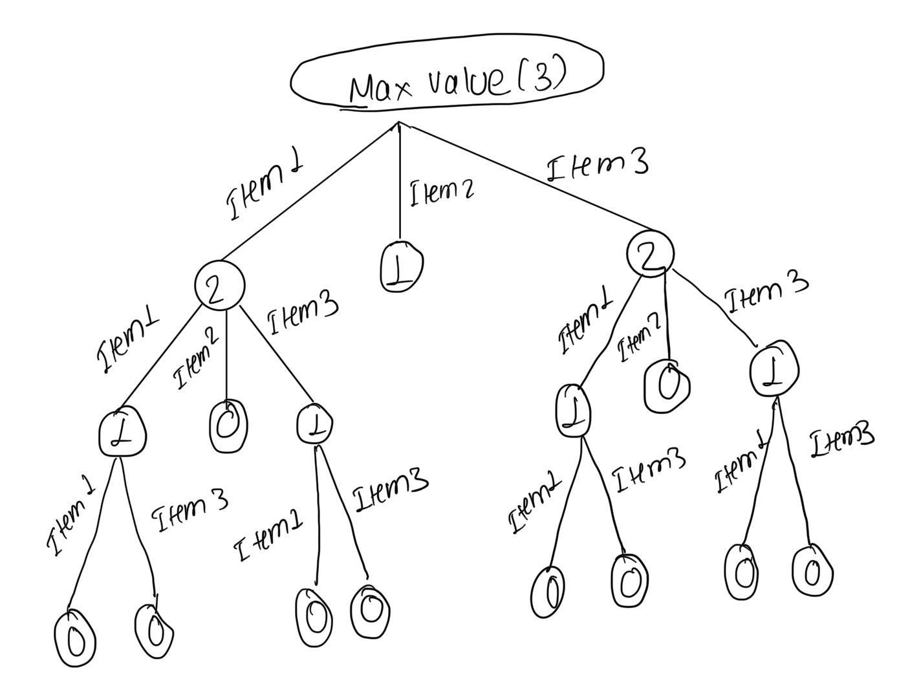

# Lab 07: The Integer-Valued Knapsack Problem

**Name:** Ritesh Ojha

## Introduction
In this lab, you will explore different variations of the Knapsack problem and design a dynamic programming solution for one of them. You may work in small groups or individually, but everyone should write up their own answers to the questions below. 

Suppose we're going hiking. We have items $1, \ldots, n$ that we could pack in multiples with corresponding values $v_1, \ldots, v_n$ and weights $w_1, \ldots, w_n$. For example, we might have a water bottle (weight 1, value 2) and a sandwich (weight 2, value 5). Consider the following three problem variations:

1. Maximize value subject to capacity $W$, where you can pack at most one of each item.
2. Maximize value subject to capacity $W$, where you can pack a positive integer value of each item.
3. Minimize weight subject to minimum value $V$, where you can pack a positive integer value of each item.

---

## Part 1: Dynamic Programming Fundamentals

**Question:** Which of the three problem variations can be solved using the dynamic programming approaches we've studied in lecture? Explain your reasoning.

*Your Answer:*

All three variations can be solved with dynamic programming. They can all be
broken into smaller problems, and we can save the answers to those smaller
problems so we do not have to solve them again.

For Variation 1, we keep track of the items we have considered and the
remaining capacity. Each item can be used once or not used. For Variation 2, we keep track of the remaining capacity. Because the items are still available after one is chosen, an item can be used more than once. For Variation 3, we keep track of the value we still need and find the smallest weight that reaches that value.

## Part 2: The Naive Recursive Algorithm

Below is a naive recursive algorithm intended to solve one of the variations listed above.

```text
Function MaxValue(W):
    if W == 0:
        return 0
        
    max_val = 0
    for i from 1 to n:
        if w_i <= W:
            current_val = v_i + MaxValue(W - w_i)
            if current_val > max_val:
                max_val = current_val
                
    return max_val
```

**Question:** Which of the three problem variations (1, 2, or 3) does this algorithm solve? How do you know? Explain your reasoning.

*Your Answer:*

The algorithm solves Variation 2 because it allows the same item to be selected more than once. It finds the highest value that fits within the weight limit. It does not solve Variation 1 because it does not track used items, and it does not solve Variation 3 because that version minimizes weight instead of maximizing value.

## Part 3: Recursion Tree

Consider the following simple example:
* **Knapsack Capacity:** $W = 3$
* **Item 1:** Weight $w_1 = 1$, Value $v_1 = 2$
* **Item 2:** Weight $w_2 = 2$, Value $v_2 = 5$
* **Item 3:** Weight $w_3 = 1$, Value $v_3 = 3$

**Question:** Draw the full recursion tree for `MaxValue(3)` using the example above. Label the remaining capacity at each node and indicate which item is chosen along each branch.



## Part 4: Recurrence Relation

**Question:** Derive a mathematical recurrence relation for $OPT(W)$, the maximum value you can pack into a knapsack of capacity $W$, based on the naive recursive algorithm. Be sure to state your base case(s) and explain how you arrived at your formula.

*Your Answer:*

Let OPT(W) be the best value we can get with capacity W. The base case is
OPT(0) = 0 because no item can fit when the capacity is zero.

For any capacity greater than zero:

```text
OPT(W) = the largest value of:
         item value + OPT(W - item weight)
         for every item that fits
```

If no item fits, OPT(W) is 0. We check every item that fits and choose the
one that gives the largest total value.


## Part 5: Bottom-Up Dynamic Programming

Instead of using the slow recursive approach, we can build a table bottom-up. 

**Question:** Use your recurrence relation from Part 4 to fill in the following table for the example provided in Part 3 ($w_1=1, v_1=2$ and $w_2=2, v_2=5$). At each step, record the optimal value and the specific item chosen to achieve that value. 

| Capacity ($W$) | Optimal Value ($OPT$) | Item Chosen |
| :------------: | :-------------------- | :---------- |
|     **0**      | 0                     | None        |
|     **1**      | 2                     | Item 1      |
|     **2**      | 5                     | Item 2      |
|     **3**      | 7                     | Item 2      |
|     **4**      | 10                    | Item 2      |
|     **5**      | 12                    | Item 2      |
|     **6**      | 15                    | Item 2      |

*Explain how you calculated the row for $W=6$*

For capacity 6, choosing Item 1 gives:

```text
2 + OPT(5) = 2 + 12 = 14
```

Choosing Item 2 gives:

```text
5 + OPT(4) = 5 + 10 = 15
```

Since 15 is greater than 14, the best value for capacity 6 is 15, and we
choose Item 2.


## Part 6: Traceback

**Question:** Using the "Item Chosen" column from the table you completed in Part 5, trace back to find the exact quantities of each item to pack that maximize the value. What is the final optimal packing configuration for $W=6$ and the maximum value?

*Your Answer:*

Starting at W = 6, choose Item 2 and subtract its weight:

- W = 6: choose Item 2, leaving 4.
- W = 4: choose Item 2, leaving 2.
- W = 2: choose Item 2, leaving 0.

Therefore, the best packing is 0 copies of Item 1 and 3 copies of Item 2.
The total weight is 6, and the maximum value is 15.
